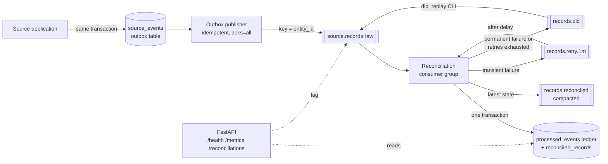

# kafka-sync-pipeline

A production-style **Apache Kafka (KRaft)** event-streaming and reconciliation pipeline that runs entirely on a laptop. A source system writes change events to a transactional outbox, a publisher streams them to Kafka, and an idempotent consumer group reconciles them into a destination database that shares no primary key with the source. Failures are retried with a delay or parked in a dead letter queue that can be inspected and replayed.

**Status:** `Maintained` - self-contained local Kafka (KRaft) outbox and reconciliation reference pipeline.

It is a personal engineering lab, built to practise the parts of Kafka that tutorials skip: what happens on duplicates, poison messages, crashes, rebalances and broker outages. Every guarantee listed below is backed by an automated test that runs against a real broker.

## What It Demonstrates
- **KRaft broker operations**: single-node Kafka without ZooKeeper, Schema Registry and PostgreSQL 16 under Docker or Podman Compose, with healthchecks and explicit topic management.
- **Transactional outbox**: events are committed with the business data, then published at-least-once by an idempotent producer (`acks=all`).
- **Schema contract**: one JSON Schema, registered in Schema Registry and enforced at both the publish and consume boundaries.
- **Idempotent consumption**: manual offset commits (`enable.auto.commit=false`) plus a deduplication ledger give exactly-once effects on top of at-least-once delivery.
- **Retry and DLQ topology**: a delayed retry topic with a bounded attempt counter, and a dead letter queue that keeps the original payload, error and origin.
- **Operations**: a DLQ inspect and replay CLI with an audit trail, and a FastAPI service exposing health, Prometheus metrics (including consumer lag) and reconciled state.
- **Failure testing**: duplicate delivery, poison pills, consumer crash and restart, group rebalance and a broker outage.

## Architecture


## Guarantees, And The Tests That Prove Them
| Guarantee | How it is achieved | Test |
|---|---|---|
| No event is lost between the database and Kafka | Outbox row is marked published only after the broker acknowledges it | `test_crash_after_broker_ack_republishes_the_batch` |
| A duplicate delivery changes state once | Ledger insert and state change share one Postgres transaction | `test_duplicate_delivery_has_exactly_once_side_effects` |
| A crash never skips a message | Offsets are committed only after the work and its output are durable | `test_crash_before_offset_commit_redelivers_without_double_applying` |
| A restart continues where it stopped | Committed offsets, not in-memory position | `test_restarted_consumer_resumes_from_last_committed_offset` |
| A poison message cannot stall a partition | Contract failures are routed to the DLQ and the offset moves on | `test_poison_pills_go_to_dlq_without_stalling_the_partition` |
| Events of one entity are applied in order | Keyed partitioning, plus cooperative rebalancing with commit on revoke | `test_rebalance_preserves_per_key_ordering` |
| An old event never overwrites newer state | Upsert guarded by the event timestamp | `test_older_event_arriving_late_does_not_overwrite_newer_state` |
| A failing dependency does not block healthy traffic | Failures move to a delayed retry topic instead of blocking the partition | `test_transient_failure_is_retried_after_the_delay_without_blocking_other_events` |
| A broker outage loses nothing | Outbox keeps accepting writes; publisher and consumer resume by themselves | `test_pipeline_recovers_from_a_broker_outage_without_losing_events` |

## Quick Start
Requirements: Docker or Podman with the Compose plugin, GNU Make, and [uv](https://docs.astral.sh/uv/).

```bash
make up      # start Kafka, Schema Registry, Postgres; apply migrations; create topics
make demo    # seed 100 events, publish them, reconcile them, show consumer lag
make test    # unit and integration tests against the running stack
make down    # stop (data is kept; `make clean` also deletes the volumes)
```

`make` on its own lists every target. The container runtime is auto-detected (`docker compose`, then `podman compose`); force one with `COMPOSE="podman compose" make up`.

| Service | From the host | From another container |
|---|---|---|
| Kafka | `127.0.0.1:9092` | `kafka:19092` |
| Schema Registry | `http://localhost:8081` | `http://schema-registry:8081` |
| PostgreSQL | `localhost:5432` (user, password and database: `sync`) | `postgres:5432` |

All ports bind to loopback. Copy `.env.example` to `.env` to move a port that is already taken.

## Running The Pieces
Each service is a long-running process. Run them in separate terminals to watch them interact:

```bash
make publisher            # poll the outbox and publish to source.records.raw
make consumer             # one member of the reconciliation group
make consumer             # a second member: watch the partitions rebalance
make seed N=500           # write 500 more events to the outbox
make lag                  # committed offset, end offset and lag per partition
make api                  # http://127.0.0.1:8000/health, /metrics, /reconciliations, /docs
```

### Working the dead letter queue
```bash
make dlq                                               # list: error type, attempts, origin, reason
make dlq ARGS="show --partition 0 --offset 3"          # headers and payload of one message
make dlq ARGS="replay --error-type retries_exhausted"  # send back what failed for outside reasons
make dlq ARGS="replay --partition 0 --offset 3 --patch '{\"payload\": {\"status\": \"active\"}}'"
make dlq ARGS="replay --dry-run"                       # validate only
```

A replayed message must pass the same contract as a new one, so a replay cannot push a bad message back in. Every replay is recorded in the `dlq_replays` table, and a message that was already replayed is skipped unless `--force` is given. Even a forced double replay is harmless, because the consumer deduplicates on `event_id`.

### Metrics
`/metrics` is computed at scrape time from committed offsets, log end offsets and the ledger table, so it covers every consumer instance and survives restarts.

| Metric | Meaning |
|---|---|
| `kafka_consumer_group_lag{group,topic,partition}` | Messages the group has not committed yet |
| `sync_events_processed_total{outcome}` | Distinct events handled, `applied` or `stale` |
| `sync_events_retried_total` | Messages routed to the retry topic |
| `sync_events_dead_lettered_total` | Messages routed to the DLQ |
| `sync_outbox_unpublished_events` | Outbox backlog |
| `sync_outbox_rejected_events` | Outbox rows parked for violating the contract |
| `sync_reconciled_records` | Rows in the destination table |
| `sync_dependency_up{dependency}` | Whether Kafka and Postgres answered the scrape |

## Topics
Created by [`scripts/init_topics.sh`](./scripts/init_topics.sh), which is safe to re-run and re-applies topic configs each time.

| Topic | Partitions | Cleanup | Retention | Purpose |
|---|---|---|---|---|
| `source.records.raw` | 6 | delete | 7 days | Change events from the source system, keyed by `entity_id` |
| `records.reconciled` | 6 | compact + delete | 30 days | Latest reconciled state per entity |
| `records.retry.1m` | 3 | delete | 1 day | Transient failures waiting for a delayed retry |
| `records.dlq` | 3 | delete | 30 days | Permanent failures, kept for inspection and replay |

## Design Notes
**Partitioning and ordering**
- **Keying by `entity_id`.** Kafka orders messages within a partition only. Hashing the entity id to a partition keeps every event for one entity in order while different entities are processed in parallel. The producer uses the `murmur2_random` partitioner so placement matches the Java clients.
- **Partition counts are fixed at creation.** Adding partitions to a keyed topic changes which partition a key hashes to, so new events for an entity could be consumed before older ones. The init script refuses to continue on a mismatch instead of repartitioning.
- **Auto topic creation is off.** A misspelled topic name fails at produce time instead of silently creating a one-partition topic.

**Publishing** ([`producer/outbox.py`](./src/kafka_sync/producer/outbox.py))
- **Outbox instead of dual writes.** Writing to a database and to Kafka separately can leave one updated without the other. The outbox row commits with the business change, and the publisher is the only thing that talks to Kafka.
- **One publisher at a time.** A Postgres advisory lock elects a leader. Two publishers reading different slices of the table could interleave one entity's events.
- **Order survives partial failure.** If one row of an entity is not acknowledged, later rows of the same entity are not marked published either, so they are re-sent after it.
- **Bad rows are parked, not retried forever.** A row that violates the contract gets a `publish_error` and leaves the queue.

**Consuming** ([`consumer/worker.py`](./src/kafka_sync/consumer/worker.py), [`consumer/reconciler.py`](./src/kafka_sync/consumer/reconciler.py))
- **Commit order is the guarantee.** Handle the message (database transaction), flush everything produced, then commit offsets. A crash at any point leaves offsets behind the work, never ahead of it.
- **Exactly-once effects, not exactly-once delivery.** Kafka transactions cannot span Postgres, so the pipeline accepts redelivery and makes it harmless with a ledger keyed on `event_id`.
- **Matching without a shared key.** The destination has its own ids, so records are matched on a natural key (document number and birth date), as in a real integration between two systems.
- **Retries trade ordering for availability.** Moving a failed message to the retry topic lets later events of the same entity overtake it. The timestamp guard on the upsert makes that safe: the retried event arrives late and is recorded as `stale`.
- **Delay without blocking.** A retry message that is not due yet pauses only its partition and seeks back, so the consumer keeps polling and stays in the group.
- **Cooperative rebalancing.** Only partitions that actually move are revoked, and finished work is committed in the revoke callback.

**Stack**
- **Two Kafka listeners.** A client reconnects to the address the broker advertises, so containers (`kafka:19092`) and host tools (`127.0.0.1:9092`) each need their own listener.
- **`records.reconciled` is compacted.** It is a changelog of current state: a new consumer can rebuild every entity's latest value without replaying the full history.

## Testing
```bash
make test-unit   # pure logic: routing policy, ordering rule, merge patch, models
make test        # everything except the disruptive tests
make chaos       # also stops and restarts the Kafka container
make lint
```

Integration tests run the real publisher, consumer, CLI and API. Each test gets its own topics and consumer group, and the session gets its own database, so the suite never touches the data in your local stack and leaves nothing behind.

## Limitations
This is a lab, and these are deliberate simplifications:
- **Single broker, replication factor 1.** There is no replication, so `acks=all` waits on one replica. A production cluster would run replication factor 3 with `min.insync.replicas=2`; the client settings used here would not change.
- **Outbox polling, not log-based CDC.** The publisher polls a table. Debezium reading the write-ahead log would remove the polling delay and the `published_at` bookkeeping.
- **One retry tier with a fixed delay.** A production topology often chains several tiers with growing delays.
- **No authentication or TLS.** Listeners are plaintext and bound to loopback.
- **`records.reconciled` carries plain JSON** without a registered schema.

## Repository Layout
```
compose.yaml               Kafka (KRaft), Schema Registry, PostgreSQL 16 with healthchecks
Makefile                   every developer entry point
scripts/                   init_topics.sh, seed.sh, wait_for_stack.sh
db/seed/                   sample outbox data
docs/PLAN.md               milestone roadmap
src/kafka_sync/
  config.py, clients.py    settings and the Kafka client configuration
  contract.py, schemas/    JSON Schema contract and Schema Registry codec
  migrations/              ordered SQL migrations and their runner
  producer/                transactional outbox publisher
  consumer/                worker loop, reconciler, retry and DLQ routing
  cli/dlq_replay.py        DLQ inspect and replay tool
  api/                     FastAPI health, metrics and reconciliations
  lag.py, snapshot.py      consumer lag and one-off topic reads
tests/                     unit, integration and chaos tests
```

See [docs/PLAN.md](docs/PLAN.md) for the milestone roadmap.

## License

MIT. See [LICENSE](./LICENSE). Copyright (c) 2026 Mariano Gabriel Parra.
